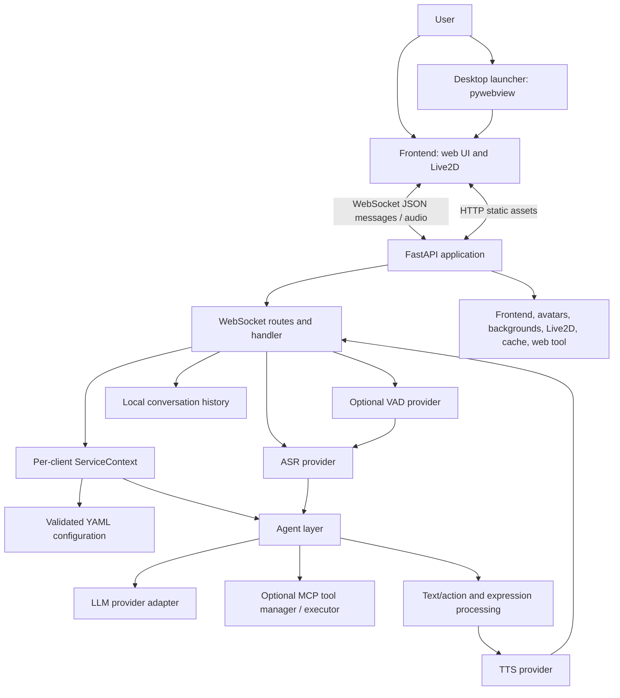

# NOVA — High-Level Design (HLD)

**Project:** NOVA — Neural Desktop Companion  
**Repository:** [Avenash005/nova-desktop-companion](https://github.com/Avenash005/nova-desktop-companion)  
**Document status:** Architecture description based on the repository's current implementation  
**Version basis:** Repository configuration and package metadata (v1.2.1)

## 1. Purpose

This document describes NOVA's system-level architecture, major components, interfaces, deployment model, and quality attributes. It is intended for developers, reviewers, and maintainers who need to understand how the desktop companion operates.

NOVA is a configurable conversational companion with a web UI/Live2D character, optional desktop-window launcher, text and voice interaction, interchangeable LLM/ASR/TTS/VAD providers, conversation history, and optional Model Context Protocol (MCP) tools.

> **Scope note:** The repository also contains NOVA-specific persona, training, evaluation, and desktop-launcher work. The core runtime is built on the Open-LLM-VTuber Python application. This document distinguishes implemented runtime features from optional or experimental capabilities.

## 2. Goals and non-goals

### 2.1 Goals

- Provide a local web interface and a floating desktop companion experience.
- Support conversational text and optional microphone-based interaction.
- Allow configuration-driven selection of language models, speech recognition, speech synthesis, and voice activity detection.
- Stream interaction between client and server over WebSockets.
- Support multiple browser/desktop clients, session contexts, chat groups, history operations, and interruption.
- Keep core runtime modules replaceable through interfaces and factories.
- Support local model services as well as compatible hosted providers.
- Make the NOVA character identity and behavior configurable.

### 2.2 Non-goals

- The application is not a general-purpose operating system shell or unrestricted system automation agent.
- The backend does not require a cloud database as its primary persistence layer.
- The project does not guarantee that every provider is fully offline; provider choice and network requirements depend on configuration.
- This HLD does not claim production-grade multi-tenant hosting, enterprise identity management, or distributed horizontal scaling.

## 3. Stakeholders and users

| Stakeholder | Interest |
|---|---|
| End user | Chat, voice interaction, desktop companion and character experience |
| Developer / maintainer | Extend providers, UI, configuration, and runtime behavior |
| Model operator | Configure and run local or remote LLM services |
| Contributor / reviewer | Understand module boundaries, interfaces, and test scope |

## 4. System context

NOVA runs as a Python application on the user's workstation. The launcher can start the backend and display the frontend in a transparent, always-on-top pywebview window, a regular desktop window, or a browser. The FastAPI application serves frontend/static assets and exposes WebSocket routes. The WebSocket server creates per-client service contexts and routes messages to conversation, history, configuration, audio, and group handlers.

The service context loads the validated YAML configuration and initializes the selected character, Live2D model, LLM agent, speech engines, and related adapters. During a conversation, input is passed to the agent/LLM; response text is transformed into display/speech segments and associated actions; TTS audio and control messages are sent back to the client.

## 5. Architecture overview

### 5.1 Logical tiers

1. **Presentation tier** — frontend assets, Live2D renderer, chat controls, microphone capture, audio playback, browser mode, and pywebview desktop modes.
2. **Transport / application tier** — FastAPI routes, WebSocket lifecycle, typed message dispatch, session bookkeeping, group coordination, and static-file serving.
3. **Conversation tier** — conversation handlers, agent abstraction, prompt/memory handling, streaming output segmentation, tool-call detection, and action extraction.
4. **AI integration tier** — LLM, ASR, TTS, VAD, translation, and optional MCP provider adapters.
5. **Configuration and local data tier** — YAML configuration, character presets, history files, model files, cached audio, logs, and training/evaluation assets.

## 6. Major components

| Component | Responsibility | Main implementation locations |
|---|---|---|
| Desktop launcher | Starts or reuses backend; chooses pet/window/browser presentation | `run_desktop_pet.py` |
| Server entry point | Loads config, initializes runtime, starts Uvicorn | `run_server.py` |
| FastAPI server | Registers routes and mounts static directories | `src/open_llm_vtuber/server.py` |
| WebSocket handler | Tracks clients and routes inbound message types | `src/open_llm_vtuber/websocket_handler.py` |
| Service context | Owns configuration and initialized engines for a session | `src/open_llm_vtuber/service_context.py` |
| Configuration manager | Parses YAML and validates typed configuration | `src/open_llm_vtuber/config_manager/` |
| Agent layer | Maintains conversational memory and coordinates response generation | `src/open_llm_vtuber/agent/` |
| LLM factory | Creates the configured model-provider adapter | `src/open_llm_vtuber/agent/stateless_llm_factory.py` |
| ASR factory | Creates configured speech recognition engine | `src/open_llm_vtuber/asr/asr_factory.py` |
| TTS factory | Creates configured speech synthesis engine | `src/open_llm_vtuber/tts/tts_factory.py` |
| VAD factory | Creates optional voice activity detection engine | `src/open_llm_vtuber/vad/vad_factory.py` |
| MCP integration | Registers tools, adapts tool schemas, executes tool calls | `src/open_llm_vtuber/mcpp/` |
| Conversation history | Creates, lists, retrieves, and deletes local histories | `src/open_llm_vtuber/chat_history_manager.py` |
| Training and evaluation | Dataset preparation, LoRA training, model evaluation | `training/` |

## 7. Key runtime workflows

### 7.1 Application startup

1. User runs `run_desktop_pet.py` or `run_server.py`.
2. Desktop launcher checks whether the configured backend endpoint is responding. If not, it starts `run_server.py` as a child process unless `--no-server` is used.
3. Server initializes logging and checks frontend submodule assets.
4. Upgrade/config synchronization is attempted.
5. `conf.yaml` is loaded and validated into typed configuration models.
6. `WebSocketServer` creates the FastAPI app and route/static mounts.
7. The default `ServiceContext` loads configured character and runtime engines.
8. Uvicorn serves the API and frontend; the launcher opens the selected presentation mode.

### 7.2 Text conversation

1. Frontend sends a `text-input` WebSocket message containing the user's text (and optional image data where supported).
2. WebSocket handler routes the message to the conversation handler.
3. The session context invokes the selected agent.
4. The agent prepares conversation memory and calls the configured LLM provider.
5. Generated output is segmented and transformed for display, optional speech, and Live2D actions/expressions.
6. The server streams text/audio/control payloads to the client.
7. Conversation state is retained by the agent/history mechanism according to the active implementation.

### 7.3 Voice conversation

1. Frontend captures microphone audio and sends audio chunks or raw audio messages.
2. When configured, VAD detects speech/silence boundaries and can signal interruption.
3. The configured ASR engine converts audio to text.
4. The recognized text is passed into the conversation workflow.
5. LLM output is segmented and sent through the configured TTS engine.
6. The client receives text and audio payloads and performs playback / character animation.

ASR and VAD may be disabled or configured to use a provider requiring an external service. Actual privacy and network behavior therefore depends on the chosen providers.

### 7.4 Interruption

The client sends an interruption message. The handler identifies the active per-client or group conversation task and delegates cancellation/interruption behavior to the conversation interrupt helpers. The configured LLM interruption method determines how the provider receives the interruption signal.

### 7.5 History and configuration

The client can request history lists, load a history, create a new history, or delete a history. It can also request available character/config presets and switch configuration. The handler uses the current client context and local history/configuration utilities, then sends typed response messages.

## 8. External interfaces and protocols

| Interface | Protocol / format | Purpose |
|---|---|---|
| Browser/desktop frontend to backend | WebSocket, JSON messages; audio payloads represented by the current client protocol | Live conversation and control |
| Browser/desktop frontend to backend | HTTP | HTML, JS, CSS, avatars, backgrounds, Live2D assets, cache |
| Backend to LLM | Provider-specific HTTP/API or local adapter | Text generation |
| Backend to ASR | Provider adapter / local inference | Speech-to-text |
| Backend to TTS | Provider adapter / local inference or remote API | Text-to-speech |
| Backend to MCP servers | MCP client transport supported by configured server | Optional external tools |
| Launcher to backend | Local HTTP readiness check | Determine whether server is ready |

### 8.1 Important WebSocket message families

The current handler includes message types for:

- Conversation: `text-input`, `mic-audio-end`, `ai-speak-signal`
- Audio: `mic-audio-data`, `raw-audio-data`
- Control: `interrupt-signal`, `audio-play-start`, `heartbeat`
- History: `fetch-history-list`, `fetch-and-set-history`, `create-new-history`, `delete-history`
- Configuration: `fetch-configs`, `switch-config`, `request-init-config`
- Groups: `add-client-to-group`, `remove-client-from-group`, `request-group-info`

The protocol is implementation-defined by the frontend and backend handlers. Changes to message names or payload structure should be coordinated across both sides.

## 9. Configuration and deployment

### 9.1 Configuration

The main runtime configuration is `conf.yaml`, with defaults/templates in `config_templates/` and character presets in `characters/`. Configuration sections include:

- System host/port and alternative configuration directory
- Character identity, persona prompt, avatar, and Live2D model
- Agent selection and agent-specific settings
- LLM provider connection settings
- ASR, TTS, VAD, and TTS preprocessing
- Live-stream integration
- Optional tool prompts and MCP server selection

Configuration is validated through Pydantic-based models before runtime initialization.

### 9.2 Deployment modes

| Mode | Behavior |
|---|---|
| `pet` | Transparent, frameless, draggable, always-on-top pywebview window |
| `window` | Regular framed desktop window |
| `browser` | Opens the local frontend in the system browser |
| Server-only | Run `run_server.py` separately and connect a browser/client |

Default runtime configuration uses a local host and port **12393**. The host/port can be changed in configuration / launcher arguments. Exposing the server beyond localhost should be treated as a security-sensitive deployment choice.

### 9.3 Runtime dependencies

The project targets Python 3.10 through 3.12 as declared in package metadata. Important runtime packages include FastAPI/Uvicorn, Pydantic, PyTorch, provider SDKs, ONNX Runtime/Sherpa-ONNX, YAML tooling, and WebSocket support. Optional provider integrations may require additional packages, model files, credentials, or separate services.

## 10. Quality attributes and architectural decisions

| Attribute | Design approach | Consideration |
|---|---|---|
| Modularity | Interfaces and factories for LLM/ASR/TTS/VAD | Provider implementations still vary in streaming and interruption behavior |
| Responsiveness | Async server, streaming output, sentence segmentation | End-to-end latency is dominated by selected model and provider |
| Extensibility | YAML configuration and provider factories | New provider must satisfy its interface and configuration contract |
| Portability | Python app, browser frontend, pywebview desktop wrapper | GPU acceleration and desktop window behavior are platform-dependent |
| Privacy | Local runtime and local history are supported | Remote LLM/ASR/TTS/MCP providers transmit data outside the machine |
| Reliability | Startup initialization, session cleanup, logs, tests | Provider availability and model download/configuration can block startup |
| Maintainability | Package separation and automated tests | WebSocket message changes require frontend/backend coordination |

## 11. Security and privacy considerations

- Keep the default bind address local unless remote access is intentionally required.
- Treat API keys, cookies, and provider credentials as secrets; do not commit live credentials.
- Validate configuration before initializing providers.
- Restrict filesystem and tool operations to explicit, configured capabilities.
- Consider authentication, origin restrictions, rate limits, and TLS before exposing the service to a network.
- Review CORS/static-file policy before remote deployment. The current server code applies permissive CORS settings; this is convenient for local development but should be tightened for an internet-facing deployment.
- Audio, text, and images sent to hosted providers are subject to those providers' data policies.
- Clear or rotate local cache/history/logs when required by user privacy expectations.

## 12. Constraints, assumptions, and risks

| Item | Impact / mitigation |
|---|---|
| Local model VRAM / RAM limits | Choose model quantization/provider appropriate to available hardware |
| Optional providers have different APIs | Keep provider-specific logic behind adapters; test each supported path |
| Frontend is a submodule | Initialize and pin submodule state when cloning/building |
| Local history and generated files | Document storage locations and backup/deletion behavior |
| CORS and unauthenticated local endpoints | Do not expose on untrusted networks without additional controls |
| README contains project-specific model/training claims | Validate claims against training scripts and evaluation artifacts when publishing a release |

## 13. Verification strategy

- Unit tests cover configuration, dataset validation, LLM factory dispatch, and localization.
- Integration tests cover live server conversation behavior where configured.
- Provider smoke tests should be run for every selected LLM/ASR/TTS combination.
- Manual acceptance should cover pet/window/browser launch, connect/disconnect, text conversation, voice flow, interruption, history operations, configuration switching, and group behavior.
- GPU/model performance numbers should be treated as environment-specific benchmark results, not general guarantees.

## 14. Repository references

- `README.md` — project overview, architecture summary, setup, and training notes.
- `run_desktop_pet.py` — desktop launcher and modes.
- `run_server.py` — initialization and Uvicorn entry point.
- `src/open_llm_vtuber/server.py` — FastAPI app, routes, and static mounts.
- `src/open_llm_vtuber/websocket_handler.py` — message protocol and connection lifecycle.
- `src/open_llm_vtuber/config_manager/` — typed configuration schema.
- `src/open_llm_vtuber/agent/` — agent and LLM integration.
- `src/open_llm_vtuber/asr/`, `tts/`, `vad/` — speech adapters.
- `src/open_llm_vtuber/mcpp/` — MCP integration.
- `training/` — NOVA dataset, fine-tuning, and evaluation tooling.

---
*End of High-Level Design.*
