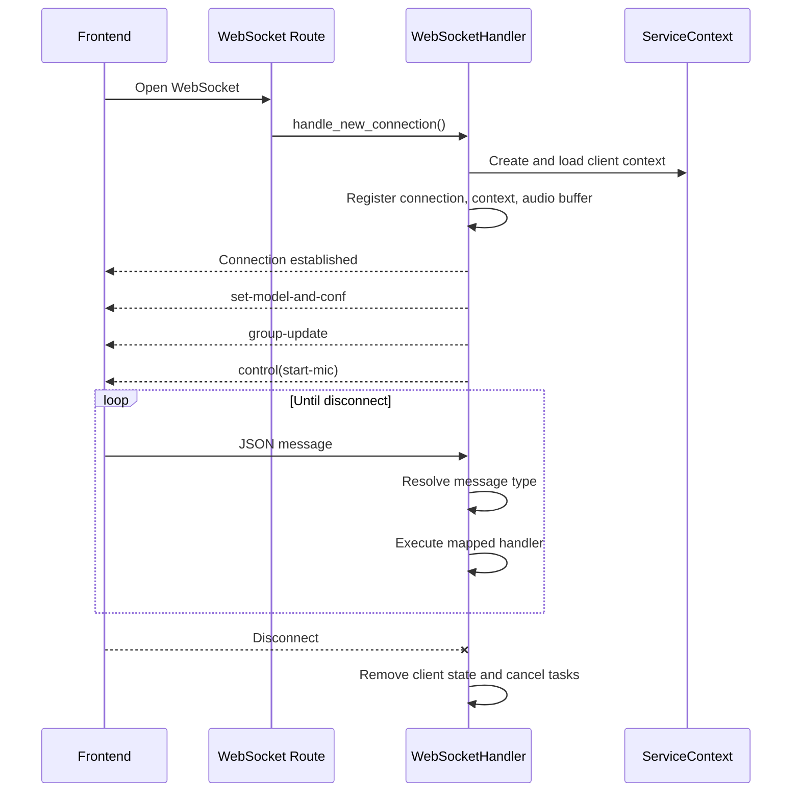

# NOVA — Low-Level Design (LLD)

**Project:** NOVA — Neural Desktop Companion  
**Repository:** [Avenash005/nova-desktop-companion](https://github.com/Avenash005/nova-desktop-companion)  
**Version basis:** Package metadata v1.2.1 and current `main` implementation  
**Companion document:** [HLD.md](./HLD.md)

## 1. Purpose and scope

This document records the implementation-level structure of NOVA: startup sequence, package responsibilities, runtime objects, WebSocket message handling, conversation processing, provider construction, local persistence, and error/cleanup behavior.

The design is based on the source currently present in the repository. The project includes additional NOVA persona and model-training assets; the runtime described here is the Python application under `src/open_llm_vtuber/`.

## 2. Technology baseline

| Area | Technology / implementation |
|---|---|
| Language | Python 3.10–3.12 (`pyproject.toml`) |
| HTTP / WebSocket server | FastAPI, Starlette, Uvicorn |
| Async execution | Python `asyncio` |
| Configuration | YAML + Pydantic configuration models |
| Logging | Loguru |
| Frontend | Versioned frontend submodule; browser UI and Live2D canvas |
| Desktop wrapper | pywebview |
| LLM layer | Provider adapters, including Ollama, OpenAI-compatible providers, Claude, llama.cpp, and Transformers |
| ASR layer | Provider adapters including Faster-Whisper, Whisper variants, Sherpa-ONNX, Azure, FunASR, and Groq Whisper |
| TTS layer | Pluggable TTS engines, including Edge TTS, pyttsx3, Piper, Sherpa-ONNX, and hosted/local service adapters |
| VAD layer | Optional Silero VAD |
| Tool integration | MCP registry, client, adapter, manager, and executor |
| History storage | Per-conversation JSON files under `chat_history/<conf_uid>/` |
| Test tooling | pytest |

## 3. Source layout and responsibilities

```text
repository/
├── run_desktop_pet.py
├── run_server.py
├── conf.yaml
├── config_templates/
├── characters/
├── frontend/                         # Frontend submodule / built assets
├── live2d-models/
├── avatars/
├── backgrounds/
├── web_tool/
├── chat_history/                     # Created at runtime
├── cache/                             # Created at runtime
├── logs/                              # Created at runtime
├── training/
└── src/open_llm_vtuber/
    ├── server.py
    ├── websocket_handler.py
    ├── service_context.py
    ├── routes/
    ├── conversations/
    ├── chat_group/
    ├── chat_history_manager.py
    ├── config_manager/
    ├── agent/
    │   ├── agent_factory.py
    │   ├── stateless_llm_factory.py
    │   ├── agents/
    │   └── stateless_llm/
    ├── asr/
    ├── tts/
    ├── vad/
    ├── translate/
    ├── mcpp/
    └── utils/
```

### 3.1 Entry points

**`run_desktop_pet.py`**
- Parses `--mode` (`pet`, `window`, `browser`), `--host`, `--port`, `--width`, `--height`, `--verbose`, and `--no-server`.
- Checks readiness through `GET /live2d-models/info`.
- Starts `run_server.py` as a child process if no server is already responding and server startup is allowed.
- Waits for readiness, then opens a browser or starts a pywebview window.
- Terminates the child server during launcher shutdown.

**`run_server.py`**
- Initializes Loguru console and rotating file logging.
- Checks/initializes the frontend Git submodule.
- Attempts configuration synchronization through `UpgradeManager`.
- Loads `conf.yaml` using `read_yaml()` and validates it using `validate_config()`.
- Constructs `WebSocketServer`, awaits its initialization, then starts Uvicorn.

## 4. Configuration model

### 4.1 Load and validation path

```mermaid
flowchart TD
  A[run_server.py] --> B[read_yaml conf.yaml]
  B --> C[Environment variable substitution: ${NAME}]
  C --> D[YAML parser]
  D --> E[Config Pydantic model]
  E --> F{Validation succeeds?}
  F -- No --> G[Log validation failure and stop initialization]
  F -- Yes --> H[WebSocketServer]
  H --> I[ServiceContext.load_from_config]
```

The configuration utility:
- Reads a text file using common encodings with a detection fallback.
- Replaces `${VARIABLE}` tokens using environment variables when present.
- Parses YAML into a mapping.
- Instantiates the top-level `Config` model; nested models validate system, character, agent, LLM, ASR, TTS, VAD, translation, and live integration settings.

### 4.2 Configuration ownership

| Configuration model | Key responsibilities |
|---|---|
| `Config` | Root object containing system, character, and live configuration |
| `SystemConfig` | Host, port, directories, and system-level prompts/options |
| `CharacterConfig` | Character identity, persona, Live2D selection, and runtime engine configuration |
| `AgentConfig` | Agent choice, agent settings, and LLM provider configuration |
| `ASRConfig` | Selected ASR provider and provider-specific settings |
| `TTSConfig` | Selected TTS provider and provider-specific settings |
| `VADConfig` | Optional VAD selection and thresholds |
| `TTSPreprocessorConfig` | Text filtering and optional translation behavior |
| `LiveConfig` | Live-stream integration settings |

### 4.3 Current default profile

The checked-in `conf.yaml` identifies the default character as NOVA, uses `basic_memory_agent`, selects `ollama_llm` as the default LLM provider, selects `edge_tts` for speech synthesis, and sets ASR and VAD to `none` by default. The configured server defaults to localhost port 12393. These are defaults, not hard-coded limitations; users may change them in configuration.

## 5. Runtime object model

### 5.1 WebSocketServer

**Location:** `src/open_llm_vtuber/server.py`

Responsibilities:
- Owns the FastAPI application and validated system configuration.
- Registers WebSocket, web-tool, and optional proxy routes.
- Mounts static directories for cache, Live2D models, backgrounds, avatars, web tool, and frontend.
- Creates a default `ServiceContext` and exposes `initialize()` to load it before Uvicorn starts.
- Provides cache cleanup at process exit.

### 5.2 ServiceContext

**Location:** `src/open_llm_vtuber/service_context.py`

Important fields:
- `config`, `system_config`, `character_config`
- `live2d_model`
- `asr_engine`, `tts_engine`, `vad_engine`
- `agent_engine`, `translate_engine`
- MCP-related `ServerRegistry`, `ToolAdapter`, `MCPClient`, `ToolManager`, and `ToolExecutor`
- `system_prompt`, `mcp_prompt`
- `history_uid`, `client_uid`, and `send_text`

Primary methods:
- `load_from_config(config)`: initialize Live2D, speech engines, VAD, MCP components, agent, and translation adapter from typed configuration.
- `load_cache(...)`: populate a client context with already-created configuration and engine references, then initialize context-specific MCP components.
- `_init_mcp_components(use_mcpp, enabled_servers)`: obtain enabled server tool descriptions, construct tool manager/client/executor when configuration permits.
- `close()`: close MCP client and close the agent when the agent exposes an async close method.

**Session ownership detail:** the WebSocket handler creates a new `ServiceContext` per connection and deep-copies Pydantic configuration models into it, but `load_cache()` receives the initialized Live2D, ASR, TTS, VAD, and agent engine objects from the default context as references. Do not assume these engine objects are independently instantiated per client. Any future change to multi-user isolation should explicitly define which objects are shared and which are session-owned.

### 5.3 WebSocketHandler

**Location:** `src/open_llm_vtuber/websocket_handler.py`

The handler maintains in-memory maps:
- `client_connections: Dict[str, WebSocket]`
- `client_contexts: Dict[str, ServiceContext]`
- `current_conversation_tasks: Dict[str, asyncio.Task]`
- `received_data_buffers: Dict[str, numpy.ndarray]`
- A `ChatGroupManager` for group membership.

It owns a message-type-to-handler map and routes each received JSON message to the matching async method. It handles new-connection initialization, initial client messages, message dispatch, heartbeat, interruption, audio buffering, history operations, config operations, background listing, and group information.

## 6. WebSocket protocol detail

### 6.1 Connection lifecycle



### 6.2 Message dispatch table

| Incoming `type` | Handler | Expected purpose / important fields |
|---|---|---|
| `text-input` | `_handle_conversation_trigger` | Starts text conversation; reads `text` and optional `images` |
| `mic-audio-data` | `_handle_audio_data` | Appends incoming sample values to client buffer |
| `raw-audio-data` | `_handle_raw_audio_data` | Sends audio chunks to VAD; handles pause/resume and speech payloads |
| `mic-audio-end` | `_handle_conversation_trigger` | Starts conversation using buffered recognized audio |
| `ai-speak-signal` | `_handle_conversation_trigger` | Proactive-speech request using configured prompt |
| `interrupt-signal` | `_handle_interrupt` | Cancels current individual or group task and updates agent interruption state |
| `fetch-history-list` | `_handle_history_list_request` | Returns available histories |
| `fetch-and-set-history` | `_handle_fetch_history` | Loads the requested history into current agent memory |
| `create-new-history` | `_handle_create_history` | Creates a new history and updates current history identifier |
| `delete-history` | `_handle_delete_history` | Deletes selected history |
| `fetch-configs` | `_handle_fetch_configs` | Lists default and alternative character configurations |
| `switch-config` | `_handle_config_switch` | Switches session configuration |
| `fetch-backgrounds` | `_handle_fetch_backgrounds` | Returns background image filenames |
| `add-client-to-group`, `remove-client-from-group` | `_handle_group_operation` | Invites/removes a participant |
| `request-group-info` | `_handle_group_info` | Returns current group members and owner status |
| `audio-play-start` | `_handle_audio_play_start` | Forwards relevant display payload to group members |
| `request-init-config` | `_handle_init_config_request` | Returns model/config/client identifiers |
| `heartbeat` | `_handle_heartbeat` | Returns heartbeat acknowledgement |

Messages are JSON objects with a required `type` field. Fields beyond `type` depend on the message. Error handling is performed within the receive loop; invalid JSON is logged and skipped, while message-handler errors are logged and returned as an `error` message when possible.

### 6.3 Outbound message examples

The current implementation emits message shapes including:
- `{"type":"full-text","text":"..."}`
- `{"type":"set-model-and-conf","model_info":...,"conf_name":"...","conf_uid":"...","client_uid":"..."}`
- `{"type":"group-update","members":[...],"is_owner":false}`
- `{"type":"control","text":"start-mic"}`
- `{"type":"heartbeat-ack"}`
- `{"type":"history-list","histories":[...]}`
- `{"type":"history-data","messages":[...]}`
- `{"type":"history-deleted","success":true,"history_uid":"..."}`
- `{"type":"error","message":"..."}`

This list is illustrative rather than a complete schema. Keep frontend/backend protocol changes synchronized.

## 7. Conversation processing

### 7.1 Trigger selection

**Location:** `src/open_llm_vtuber/conversations/conversation_handler.py`

- For `text-input`, user input is read from `data["text"]`.
- For `mic-audio-end`, the accumulated client audio buffer is used and reset.
- For `ai-speak-signal`, a configured proactive-speech prompt is loaded; metadata flags can exclude that turn from memory/history.
- If the client belongs to a multi-member chat group, a group task is created using the group ID as the task key.
- Otherwise, a single-conversation task is created using the client UID as the task key.

### 7.2 Single conversation

**Location:** `src/open_llm_vtuber/conversations/single_conversation.py`

The single-conversation worker accepts a session context, send callback, client ID, input, optional images, and metadata. It coordinates agent input/output and sends processed response events to the requesting WebSocket. The worker is executed as an asyncio task so it can be interrupted independently of the receive loop.

### 7.3 Group conversation

**Location:** `src/open_llm_vtuber/conversations/group_conversation.py`

The group worker receives the relevant client contexts/connections, broadcast callback, participant list, initiating client, and input. Group membership and conversation state are coordinated through `ChatGroupManager` and group conversation state helpers. A group task is keyed by its group ID to avoid starting concurrent group turns for the same active group.

### 7.4 Agent output transformation

**Primary implementation:** `src/open_llm_vtuber/agent/agents/basic_memory_agent.py`

The basic memory agent:
1. Builds the input message from text and supported image data.
2. Combines the request with the agent's working conversation memory.
3. Calls its configured stateless LLM adapter.
4. Optionally handles tool-call events when MCP is enabled.
5. Accumulates generated text and emits sentence-oriented output.
6. Extracts display/Live2D action data and filters text for TTS.
7. Updates working memory subject to metadata flags.
8. Supports loading memory from stored history and handling interruption.

The `AgentInterface` defines asynchronous streaming `chat()`, `handle_interrupt()`, and `set_memory_from_history()` contracts. Agent implementations should preserve these contracts.

## 8. Provider construction and interfaces

### 8.1 LLM

**Factory:** `agent/stateless_llm_factory.py`  
**Agent selection:** `agent/agent_factory.py`

The agent factory selects the configured conversation agent. For `basic_memory_agent`, it retrieves the selected LLM provider and its configuration, creates the LLM through `LLMFactory`, and injects the system prompt and optional MCP components into `BasicMemoryAgent`.

Provider families currently wired in `LLMFactory` include:
- OpenAI-compatible endpoints (also used for several provider-specific configurations)
- Ollama
- Llama.cpp
- Claude
- Transformers

The LLM adapter implements the stateless LLM interface used by the agent. Provider configuration includes model, endpoint, credential, temperature, and provider-specific options where applicable.

### 8.2 ASR

**Factory:** `asr/asr_factory.py`

`ASRFactory.get_asr_system(name, **kwargs)` returns `None` for a disabled/empty provider or instantiates the selected implementation. Examples include Faster-Whisper, Whisper.cpp, OpenAI Whisper, FunASR, Azure ASR, Groq Whisper, and Sherpa-ONNX.

### 8.3 TTS

**Factory:** `tts/tts_factory.py`

`TTSFactory.get_tts_engine(type, **kwargs)` constructs the configured TTS engine. The factory includes local and external service variants; credentials and model/service configuration are provider-specific. Generated speech is consumed by the conversation/output pipeline and served to the client through the runtime's audio payload mechanism.

### 8.4 VAD

**Factory:** `vad/vad_factory.py`

`VADFactory.get_vad_engine()` returns no engine if VAD is disabled or creates the configured Silero VAD implementation with sample rates and detection thresholds.

### 8.5 Translation and MCP tools

Translation is initialized through `TranslateFactory` according to the TTS preprocessor translation configuration. MCP initialization uses:
- `ServerRegistry` to represent configured MCP servers.
- `ToolAdapter` to fetch and normalize tool definitions for model providers.
- `ToolManager` to retain provider-formatted and raw tool definitions.
- `MCPClient` to communicate with MCP servers.
- `ToolExecutor` to execute selected tool calls.

MCP is optional and must be enabled in the agent configuration with a non-empty enabled-server list.

## 9. Local data and persistence

### 9.1 Conversation histories

**Location:** `src/open_llm_vtuber/chat_history_manager.py`

Storage layout:

```text
chat_history/
└── <conf_uid>/
    ├── <history_uid>.json
    └── ...
```

A history file begins with a metadata record. Conversation entries contain:
- `role`: `human` or `ai`
- `timestamp`: local ISO timestamp
- `content`: message text
- Optional `name` and `avatar` display fields

Core functions:
- `create_new_history(conf_uid)`
- `store_message(conf_uid, history_uid, role, content, ...)`
- `get_history(conf_uid, history_uid)`
- `get_history_list(conf_uid)`
- `delete_history(conf_uid, history_uid)`
- `get_metadata(...)` and metadata update helper

History identifiers are generated using a timestamp plus UUID. Path components are sanitized and restricted to prevent path separators and unsafe filename characters. Files are JSON encoded as UTF-8.

### 9.2 Other runtime files

| Location | Purpose |
|---|---|
| `conf.yaml` | Active user configuration |
| `characters/` | Alternative character configurations |
| `models/` | Model assets and caches, where configured |
| `cache/` | Generated/static runtime cache, including audio access |
| `logs/` | Rotating server logs |
| `chat_history/` | Local conversation files |
| `training/dataset/` | Fine-tuning source and split datasets |
| `training/evaluate/` | Evaluation scripts and result artifacts |

## 10. Error handling and lifecycle

- YAML parsing and Pydantic validation errors are logged and propagated; server initialization cannot safely proceed with invalid required configuration.
- Provider construction may raise for unsupported provider names or invalid configuration.
- Connection setup wraps context creation and registration; failures trigger failed-connection cleanup.
- The WebSocket receive loop catches malformed JSON, logs handler exceptions, and attempts to send a protocol-level error.
- Client disconnect cancels its active conversation task and removes tracked client state.
- Service context closure is responsible for closing MCP and agent resources.
- The launcher waits for server readiness and terminates a child process on exit or failed startup.

## 11. Security and operational considerations

1. Default configuration binds to localhost. Remote binding should not be enabled without a deployment security review.
2. The FastAPI app currently applies permissive CORS settings. Tighten allowed origins/methods/headers before exposing the service to an untrusted network.
3. Never commit real provider API keys, cookies, or access tokens to `conf.yaml`.
4. The configuration reader supports environment-variable substitution; use that mechanism for secrets where supported.
5. MCP tool availability is capability-bearing. Enable only trusted servers and review each exposed tool.
6. History files and generated cache may contain user data. Users need clear retention and deletion behavior.
7. Local execution does not imply all inference is local: the configured model, speech, translation, and MCP providers determine where data is processed.

## 12. Implementation notes and follow-up engineering

These are design considerations, not claims that the current release already implements them:

- Define and test an explicit session-ownership policy for agent and audio engine instances. Current `load_cache()` receives engine references from the default context.
- Add a versioned, formal WebSocket JSON schema and protocol compatibility tests.
- Add authentication and restrictive CORS/origin policy before supporting LAN or public exposure.
- Add integration coverage for actual provider combinations, reconnect behavior, interruption, group sessions, and MCP failures.
- Consider atomic writes for JSON history files to reduce corruption risk during abrupt termination.
- Document local history/cache/log locations in the UI and provide retention controls.
- Add resource limits for inbound audio/image payloads and concurrent conversations.

## 13. Test mapping

| Test area | Existing evidence / recommended verification |
|---|---|
| Configuration | `tests/test_config.py` |
| Dataset preparation | `tests/test_dataset.py` |
| LLM factory | `tests/test_llm_factory.py` |
| Localization | `tests/test_localization.py` |
| Live conversation | `tests/test_live_server_conversation.py` |
| WebSocket lifecycle | Add connect/disconnect and message-dispatch coverage |
| History | Add create/store/list/load/delete and unsafe-path tests |
| Audio | Add mocked ASR/VAD/TTS pipeline and provider error tests |
| MCP | Add server unavailable, invalid tool, timeout, and cleanup tests |

---
*End of Low-Level Design.*
